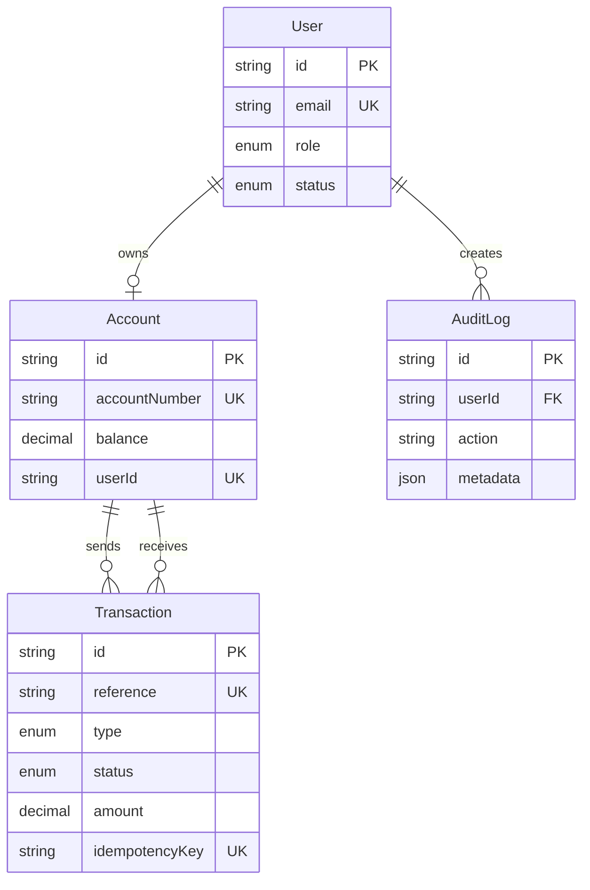

# SecureTx

SecureTx is a banking-style demo application for secure PKR account management, transfers, transaction history, auditability, and role-based administration.

## Features

- JWT authentication with secure HTTP-only cookies
- Customer registration with a PKR 50,000 demo opening deposit
- Atomic transfers with Decimal money arithmetic, row locks, idempotency, and limits
- Dashboard with balance, activity chart, and recent transactions
- Filterable transaction history with CSV export and printable receipts
- Admin KPIs, user freeze/unfreeze, transaction monitoring, and audit logs
- Password lockout, change-password flow, rate limiting, security headers, and masked counterparties
- Responsive Tailwind UI with light/dark theme support

## Tech Stack

Next.js 15 App Router, TypeScript, PostgreSQL, Prisma, Zod, jose, bcryptjs, Tailwind CSS, shadcn-style Radix UI primitives, Recharts, Vitest, and Vercel/Neon deployment.

## Architecture

Route handlers authenticate and validate requests, services own business logic, Prisma owns persistence, and client screens consume JSON APIs. Middleware protects page routes at the Edge with jose; every protected API route performs its own database-backed authorization check.



## API

| Method | Path | Auth | Description |
|---|---|---|---|
| POST | `/api/auth/register` | Public | Register a customer and create the opening deposit |
| POST | `/api/auth/login` | Public | Authenticate and set the session cookie |
| POST | `/api/auth/logout` | Session | Clear the session cookie |
| GET | `/api/auth/me` | Session | Return the current safe user projection |
| POST | `/api/auth/change-password` | User | Change password after current-password verification |
| GET | `/api/account/summary` | User | Return the authenticated user's account dashboard data |
| GET | `/api/settings` | User | Return profile and recent login events |
| GET | `/api/accounts/lookup` | User | Return a masked recipient name and verified status |
| POST | `/api/transfers` | User | Validate and execute an atomic transfer |
| GET | `/api/transactions` | User | Filter and paginate the user's own transactions |
| GET | `/api/transactions/[id]` | User | Return an owned transaction detail |
| GET | `/api/transactions/export` | User | Export filtered owned transactions as CSV |
| GET | `/api/admin/overview` | Admin | Return platform KPIs and recent operational events |
| GET | `/api/admin/users` | Admin | Search and paginate users |
| PATCH | `/api/admin/users/[id]/status` | Admin | Freeze or unfreeze a customer |
| GET | `/api/admin/transactions` | Admin | Filter and paginate all transactions |
| GET | `/api/admin/audit-logs` | Admin | Filter and paginate audit events |

## How Transfers Stay Safe

- **Atomic database transaction:** account updates and the transaction record commit or roll back together.
- **Row locking:** both account rows are locked in sorted ID order with `SELECT ... FOR UPDATE` before balances are re-read.
- **Idempotency keys:** duplicate requests return the original transaction and never move money twice.
- **Limits:** PKR 1 minimum, PKR 100,000 per transfer, and PKR 200,000 daily outgoing limit in Asia/Karachi time.
- **Audit log:** successful and failed transfer events include actor, request context, reason, and metadata.
- **Ownership checks:** customer endpoints always scope records through the authenticated user's account.

## Security Measures

- HS256 JWTs expire after one hour and contain only `userId` and `role`.
- Session cookies are HTTP-only, `SameSite=Lax`, path-scoped, and secure in production.
- Passwords use bcrypt with cost 12; login errors are generic.
- Five failed logins lock an account for 15 minutes.
- Auth and transfer routes have in-memory per-IP rate limits.
- Admin pages and APIs require `ADMIN`; customers receive a clean 403 page.
- Security headers include CSP, frame denial, MIME sniffing protection, Referrer Policy, and Permissions Policy.
- Password hashes, tokens, and full request bodies are never returned or logged.

## Getting Started

```bash
git clone <repository-url>
cd secure-transaction-management-system
npm install
cp .env.example .env
```

Set `DATABASE_URL` to a PostgreSQL connection string and `JWT_SECRET` to a random value of at least 32 characters. Then run:

```bash
npx prisma generate
npm run db:push
npm run db:seed
npm run dev
```

Open http://localhost:3000.

## Demo Credentials

| Role | Email | Password |
|---|---|---|
| Admin | `admin@securetx.demo` | `Admin@12345` |
| Customer | `ali@securetx.demo` | `Customer@12345` |

Additional seeded customers are `sara@securetx.demo` and `usman@securetx.demo`, both using `Customer@12345`.

## Tests

The transfer suite uses a mocked Prisma transaction client and covers success, insufficient funds, self-transfer, per-transaction limits, daily limits, duplicate idempotency, and concurrent overspending.

```bash
npm test
npx vitest run tests/transfer.service.test.ts
npm run typecheck
npm run lint
npm run build
```

## Vercel + Neon Deployment

1. Create a Neon PostgreSQL project and copy its pooled connection string.
2. Import this repository into Vercel.
3. Add `DATABASE_URL` and a 32+ character `JWT_SECRET` to Vercel Environment Variables for Preview and Production.
4. Use `npm run build` as the build command; Prisma Client is generated by `postinstall`.
5. Run `npx prisma db push` against Neon, then run `npm run db:seed` only for a demo environment.
6. Deploy and verify HTTPS cookie behavior, login, dashboard, transfer, export, and admin authorization.

## Future Improvements

2FA, email notifications, Redis-backed rate limiting for multi-instance deployments, stronger observability, and formal database migrations instead of `db push`.

## Disclaimer

SecureTx is a portfolio/demo application. It does not hold, process, or represent real money and must not be used for real financial activity.
